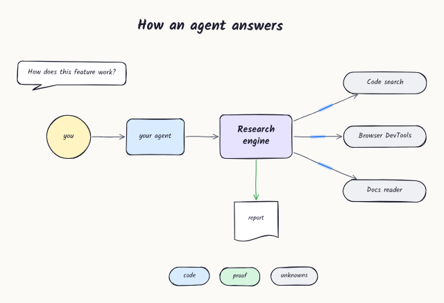

# FlowSketch Studio

A browser-based editor for **hand-drawn flow diagrams that gently come alive**. Shapes float, wobble or "boil" like hand animation. Arrows show the direction of flow with a travelling highlight, a draw-on stroke, marching dashes or a pulse. Everything is configurable, down to switching motion off entirely. You can save editable `.flowsketch` projects and export animated GIFs, video, PNG/JPEG, SVG or a self-contained HTML player. Everything runs locally in the browser, with no account and no server.



**What's changed:** see [CHANGELOG.md](CHANGELOG.md), also shown in the app under Help ▸ What's new.

## Quick start

```bash
npm install
npm run dev        # http://localhost:5173  (also builds the HTML-player bundle first)
npm run build      # type-check + production build into dist/
npm run preview    # serve dist/ on http://localhost:4173
npm test           # unit tests (Vitest, 189 tests)
npm run test:e2e   # end-to-end acceptance tests (needs `npm run preview` running; see below)
```

### Desktop app (macOS)

FlowSketch can also be built as a normal Mac app, `FlowSketch.app`, with [Tauri](https://tauri.app). It is the same app in its own window: no browser, no server, no npm in daily use. Save, Open and every export use the native macOS dialogs.

**One-time setup** (skip any step you have already done):

```bash
xcode-select --install                                           # Apple's command-line tools
curl --proto '=https' --tlsv1.2 -sSf https://sh.rustup.rs | sh   # Rust, which Tauri uses to build the app; then open a new Terminal window
```

You also need Node 18 or later (`node --version`; install it from [nodejs.org](https://nodejs.org) if it is missing) and a copy of this repository:

```bash
git clone https://github.com/bagcheap/FluidFlowSketchStudio.git
cd FluidFlowSketchStudio
```

**Build and install:**

```bash
npm install
npm run app:build                            # first build takes 5–10 minutes; later ones are quicker
open src-tauri/target/release/bundle/macos   # drag FlowSketch.app into Applications
```

Open it from Applications, Launchpad or Spotlight. To keep it in the Dock, right-click its Dock icon ▸ Options ▸ Keep in Dock.

**Updating to a new version:**

```bash
git checkout -- package-lock.json   # drop the lockfile changes npm install makes, so the pull isn't refused
git checkout main && git pull
npm install                         # only needed when a release says it adds packages; harmless otherwise
npm run app:build
open src-tauri/target/release/bundle/macos   # drag the new FlowSketch.app into Applications and replace the old one
```

Your diagrams, autosave, preferences and icon libraries are kept: they are stored separately from the app itself. Help ▸ About shows the version you are running.

`npm run app:dev` opens the app window on top of the dev server, with live reload, for trying a branch without installing it.

**Moving from the browser version:** the app keeps its own autosave, recent files, preferences and icon libraries, separate from the browser at `localhost:5173`. Export each icon library in the browser (Icons ▸ Manage ▸ Export) and import the `.flowsketchlib` files in the app; save open diagrams as `.flowsketch` files and open them in the app.

**Troubleshooting:**

- **`git pull` says "Your local changes would be overwritten" (`package-lock.json`):** run `git checkout -- package-lock.json` and pull again. It only throws away the copy `npm install` rewrote.
- **`cargo` or `rustc`: command not found:** open a new Terminal window, or run `source "$HOME/.cargo/env"`.
- **About still shows the old version:** the app was built before the update. Run `npm run app:build` again and replace the app in Applications.
- **macOS says the app can't be opened or is from an unidentified developer:** right-click FlowSketch.app ▸ Open, then Open once. The app is built on your Mac and isn't signed with an Apple developer account.
- **The build fails:** run `rustup update` and `npm install`, then try `npm run app:build` again. If it still fails, the last 20 lines of the Terminal output say why.

Requirements: Node 18+ (tested on Node 22). The e2e suite uses Python 3 with `playwright` and `Pillow` (`pip install playwright pillow && python3 -m playwright install chromium`).

## The 60-second tour

1. **Draw.** Press <kbd>U</kbd> (rounded rectangle) and click to drop a shape or drag to size it (<kbd>Shift</kbd> keeps proportions). **The tool stays active.** Draw as many as you like, then press <kbd>Esc</kbd> or <kbd>V</kbd> to go back to Select.
2. **Style once, reuse.** With a drawing tool active, the inspector edits *that tool's remembered defaults*. Defaults are stored separately per tool (blue rectangles and red diamonds stay that way) and persist across sessions. Existing objects are never changed by editing defaults. Select objects to edit them instead.
3. **Write.** Double-click a shape or arrow, or press <kbd>Enter</kbd>, to type. Shapes grow to fit their text.
4. **Connect.** Press <kbd>A</kbd> and drag from one shape to another. Connectors are real relationships: they follow shapes when moved, resized or animated. Drop near a side's dot to pin to that port. Drag mid-dots to add bends, and switch Straight / Curved / Elbow in the inspector. **Swap direction** (inspector, or Arrange ▸ Swap arrow direction) reverses an arrow without redrawing it.
5. **Add icons.** Press <kbd>Shift</kbd>+<kbd>I</kbd> (or the grid button at the end of the toolbar) to open the Icons panel: 12,884 icons from [Tabler Icons](https://tabler.io/icons) (MIT), [Devicon](https://devicon.dev/) (MIT), [SVG Logos](https://github.com/gilbarbara/logos) (CC0), [Simple Icons](https://simpleicons.org/) (CC0) and the [Kubernetes icons](https://github.com/kubernetes/community/tree/master/icons) (Apache-2.0). Search them all, then drag an icon onto the canvas or click to add it. **Add icons** builds your own libraries from SVG/PNG files, folders, ZIPs or Iconify JSON, and imports the official AWS, Azure and Google Cloud icon ZIPs you download from each provider, and **Manage** exports them as `.flowsketchlib` files to share. Brand logos remain trademarks of their owners. Icons attach to arrows, take a label, animate like shapes, and can be recoloured, drawn hand-drawn or given a circle or square background in the inspector.
6. **Group in containers.** Select shapes, right-click and choose **Add container**: a titled frame that moves everything inside it. Shapes dragged in join it, shapes dragged out leave it, and it grows to fit. Right-click anywhere for the most common actions (Shift+F10 from the keyboard).
7. **Play.** <kbd>K</kbd> or the play button. Use the **Squiggle** slider (0–10) for motion and **Hand-drawn** for static sketchiness; the two are independent.
8. **Save & export.** <kbd>Ctrl/⌘ S</kbd> saves a `.flowsketch` file. Work also autosaves in the browser. **Export GIF** renders a seamless loop.

The full shortcut list is under Help ▸ Keyboard shortcuts (<kbd>?</kbd>).

## Animation controls

There are three layers of settings, applied in order:

| Layer | Where | Notes |
|---|---|---|
| Document defaults | Animation ▸ Global animation settings | Duration, loop, seamless snapping, global squiggle/speed multipliers, default shape motion and arrow flow, synchronise / randomise phases, reduced-motion mode |
| All arrows | Inspector with nothing selected ▸ *Arrow highlight (all arrows)* (also in the Animation settings dialog) | Highlight thickness, colour, return colour, segments, length, opacity, glow and round-trip pause for every arrow on every page at once, plus the overall arrow speed (which also sets how fast arrows playing in order move). Each change replaces that one setting on every arrow (locked ones excepted) and in the arrow tools' remembered style, so new arrows follow too |
| Shape motion | Inspector with nothing selected ▸ *Shape motion* | One control for how much every shape moves: Still, Calm, Natural or Lively |
| Playing in order | Inspector with nothing selected ▸ *Playing in order* (also in the Animation settings dialog) | Pause between steps (0–5 s), step captions with their size and position (bottom or top), highlight each step, camera follows steps |
| Per-object overrides | Inspector ▸ *Shape animation* / *Arrow animation* | Only the values you touch are stored; a blue dot marks an override. ↺ resets a value or a whole section to the document default |
| Playback preview | Bottom bar | Play/pause, stop, restart, scrub, length, speed, loop, all-motion on/off. Nothing here changes saved geometry |

**Shape motion modes:** Gentle float · Organic wobble (smooth outline deformation) · Sketch boil (cycles between three stable hand-drawn variants) · Soft sway (tiny rotation) · Combined (default) · Off. The per-object parameters are squiggle intensity, speed, movement amplitude, rotation, deform, smoothness, phase, delay, and text behaviour (moves with shape / stays stable / drifts on its own). Text glyphs are never deformed.

**Arrow modes:** Travelling highlight (colour, length, thickness, opacity, segment count, round/square ends, glow) · Draw on (drawing share, pause, optional erase-from-tail; the arrowhead rides the leading tip) · Marching dashes · Pulse · Static. Every mode also has speed, direction, delay and an optional arrowhead pulse. All of them follow the true connector geometry, including curves and elbows.

**Seamless loops.** With *Seamless* on (the default), every frequency is snapped to a whole number of cycles per loop, so position and velocity match at t = 0 and t = L. Per-object *delays* ease in and therefore break seamlessness; the GIF dialog warns when this applies.

## Saving

* **Native format:** `.flowsketch` is versioned JSON (`format`, `schemaVersion`). It contains all geometry, text, z-order, groups, connector relationships, styles, animation settings, seeds, embedded raster images (data URLs) and export preferences, and never any executable content. On import, every value is validated and coerced. Unknown types are skipped, dangling connector references are detached, duplicate IDs are reissued, and SVG or other non-raster image data is refused. Files from a newer schema version produce a clear error, and older versions are migrated (`src/model/schema.ts`).
* **Save / Save as.** Chromium browsers write back to the same file via the File System Access API. Other browsers fall back to a download.
* **Close.** File ▸ Close leaves a blank diagram, asking first (Save / Don't save / Cancel) when there are changes not saved to a file.
* **Autosave & recovery.** IndexedDB, about 0.7 s after each change. The last session is restored on reload. File ▸ Recent documents lists up to 12 documents and can restore the autosave.
* Templates: File ▸ New from template (7 built-ins). File ▸ Save as custom template stores your own.

## Exporting

| Format | Notes |
|---|---|
| **Animated GIF** | Size presets of 640 / 1280 / 1920 or custom. 10/15/24/30 FPS, duration, loop count, canvas/white/transparent background, margin, fit-to-content or current view, selection only, 16–256 colours, shared palette, ordered dithering. Shows a live preview at the chosen frame rate, an estimated size, warnings, a progress bar, cancel and retry. Frames are rendered at exact timestamps (`i·L/N`) on an offscreen canvas, so the tab does not need to be visible. Quantisation and encoding run in a Web Worker (gifenc) with one frame in flight, which keeps memory flat. Delays use centisecond rounding so the total stays exact. |
| Video | WebM (VP9/VP8) or MP4 wherever `MediaRecorder` supports it (capability-checked). Recorded in real time, so keep the tab visible. |
| PNG / JPEG | Scale 1–4×, transparent PNG, crop to content or view, margin, selection only, any timestamp. |
| SVG | Real vector paths and `<text>` for the chosen frame. Fonts can optionally be embedded. |
| Standalone HTML | One file containing the document plus the player engine and fonts. It plays offline; click to pause. |
| Clipboard | Copies a PNG image. |

GIFs are limited to 256 colours and compress poorly. For long or large animations, video is usually far smaller.

## Describe a diagram with AI (optional)

Insert ▸ **Describe a diagram (AI)…** (also on the canvas right-click menu). You describe a diagram in plain words and Claude drafts it. You can check or edit the draft, ask for changes, and then insert it. This is the only FlowSketch feature that uses the internet. It is off until you use it, and it needs your own Anthropic API key. Everything else keeps working without one.

### 1. Get an Anthropic API key (one time)

1. Go to **https://platform.claude.com** (the Claude Console; `console.anthropic.com` takes you to the same place). Sign up or sign in. This is separate from a claude.ai chat subscription: API use is billed on its own.
2. Add credit: open **Billing** (under Settings), add a payment method and buy some prepaid credit. A few dollars is plenty to try it.
3. Create a key: open **API keys**, choose **Create key**, give it a name such as `FlowSketch`, and create it.
4. **Copy the key right away** (it starts with `sk-ant-`). The Console shows it only once. If you lose it, delete it there and create a new one.
5. Keep it private. Don't paste it into files in this repo, chats or screenshots. Anyone who has it can spend your credit. You can delete the key in the Console at any time.

### 2. Use it in FlowSketch

1. Open Insert ▸ **Describe a diagram (AI)…**.
2. Paste the key into **API key**. To avoid pasting it again next time, tick **Remember in the macOS Keychain** (desktop app) or **Remember in this browser (encrypted with a passphrase)** (browser; choose a passphrase of at least 8 characters, and type it once per tab to unlock the key). **Forget key** removes it.
3. Choose a **Model**: Opus (best, the default), Sonnet (faster, cheaper) or Haiku (fastest, cheapest).
4. Describe the diagram, for example: *"A user signs in through the web app, which checks the auth service, then loads their orders from the API and its database. Number the steps."* Then press **Draw it**. It takes a few seconds to a minute.
5. A Mermaid draft appears below, and your prompt stays in the box. Now you can:
   * edit the draft directly;
   * tweak the prompt and press **Draw again** for a fresh draft from just that prompt;
   * type a change ("add a cache between the API and the database") and press **Change draft**. Claude gets the current draft plus your change.
6. Press **Insert diagram**. It's laid out and animated like any diagram from text. Numbered steps play in order.

**Changing step numbers later:** edit an arrow's label. Typing a number another arrow already has (say "7b" → "8") moves the later steps up (8 → 9, 9 → 10…); deleting an arrow or removing its number moves the later ones down again (with 3 gone, 4 becomes 3). A play order that came from the labels follows along. A new arrow plays after the last step until you give it a number (so does one whose label has no clear number), and an arrow whose animation is turned off is skipped. To reorder by hand, use Animation ▸ Set play order, then Animation ▸ **Renumber step labels** to rewrite the numbers to match. Animation ▸ **Play in label order on every page** refreshes the order on all pages.
7. The dialog remembers your last session on this computer. Open it again later and the prompts you used are listed under **Prompts used for this draft**, and the Mermaid that was drawn (with your edits) is still there. **Edit** next to a prompt puts it back in the box to tweak and try again. **Start over** clears it all.

**What is sent, and where:** only the text you type in this dialog (plus the current draft when you ask for a change). It goes straight from your browser or the desktop app to Anthropic's API, and only when you press **Draw it** or **Change draft**. With Describe a diagram, your diagram file and anything else on the canvas are never sent (Change this page, below, does send the page). Claude's reply is read only as Mermaid text and goes through the same checks as Mermaid you paste yourself. Nothing in it is ever run.

### 3. Change a diagram that's already on the page

Insert ▸ **Change this page (AI)…** (also on the canvas right-click menu) works on what you've already drawn.

1. Type what should change, for example: *"Add a cache between the API and the database, colour all databases green, and number the arrows in the order a request flows."* Then press **Suggest changes**.
2. Claude's suggestions are listed in plain words, for example "Add cylinder “Cache” below “API”" and "Connect “API” → “Cache”". Untick any you don't want.
3. Press **Apply**. The changes are made as one step, so one ⌘Z undoes them all, and what was added or changed is selected.

What it can do: add shapes (next to a shape you name), connect shapes, remove things, rename, change a shape's kind, recolour, change an arrow's style, heads or direction, put shapes in a container, or move them in or out of one. Everything else on the page stays as it is, including positions, styles and animation.

**What is sent for a change:** this page's text, the kinds of shapes, their colours and positions, the arrows between them and the containers, with your request. Pictures, other pages and anything else in the file are not sent. Claude's reply is a list of changes in a fixed format. Each one is checked (it must name something that's on the page, a known shape kind, a real colour) before it's shown to you, and nothing in it is ever run.

### 4. Have Claude check a diagram

Insert ▸ **Review with Claude (AI)…** (also on the canvas right-click menu, and at the bottom of the Review panel) checks that the page is *right*, not just tidy.

1. Fill in the **brief**: what the diagram shows, the system or domain (for example "Microsoft Entra ID, OAuth 2.0"), who it's for, any assumptions, and what you want checked. The brief is saved with the diagram, so next time it's already there.
2. Choose **Effort**: Medium (recommended) or High (for large or important diagrams; costs more). Leave **Include a picture of the page** on so Claude can see the layout. **Search the web for current facts** lets Claude look up things that may have changed since it was trained; each search costs extra, and your organisation may need to turn web search on in the Anthropic Console first.
3. Press **Review**. The findings appear at the top of the Review panel. Each has a severity, what's wrong and a suggested change. Click a finding to select the items it's about. Claude may also ask you questions, and with web search it lists its sources. The download button at the top of Claude's review saves it as **Markdown notes** in a file you choose.

The dialog remembers what you entered: the brief is saved with the diagram as you type, and your choices are kept for next time. **Clear form** empties the brief and puts the options back to how they started (your key and model stay).

A review usually costs a few cents with Opus 5.5 at Medium; the panel shows the estimate (web searches are extra). Claude can be wrong, so treat findings as a second opinion.

**What is sent for a review:** the brief, this page's labels, shape kinds, colours, positions, arrows and containers, the play order and the automatic checks, plus a picture of the page and the hover notes if you tick them. Open **What will be sent** in the dialog to see the exact text. Other pages and anything else in the file are not sent. Claude's reply comes back in a fixed format and is checked before it's shown; nothing in it is ever run.

### 5. Let Claude make the changes, step by step

Insert ▸ **Edit with Claude (AI)…** (also on the canvas right-click menu, and **Fix with Claude…** on each finding of a review) lets Claude change the page itself, for example *"Add a token cache between the API and the identity provider, connect it, and renumber the steps."*

1. Type what should change, choose **Effort** (Medium for most changes, High for large restructures) and whether Claude may **look at pictures of the draft** to check its work, then press **Run**.
2. Claude works on a **draft**: the panel lists each step as it happens and the cost so far, and the canvas shows the draft with additions outlined in green, changes in amber and removed items in red. Press **Stop** to halt it.
3. Read Claude's summary and the list of changes. Then **Apply** (all of it, as one step: one ⌘Z takes it back), type more in **Ask for more changes** and press **Send** to refine the same draft, or **Discard**.

While a draft is shown you can pan and zoom, but editing waits until you apply or discard, so the draft and your diagram never get mixed up.

**Keeping the cost in check:** each run has a **step limit** (5, 12 or 25 requests to Claude; 12 by default) and a **spending limit** ($0.25 to $2, or none; $0.50 by default), set under **Limits** and remembered. Before you press Run the panel shows an **estimated cost**: typical, and the most it could cost within your limits (a rough guide from the page size and list prices). While it runs, the header shows the step and the spend so far. The run stops before the next step would go over either limit and keeps the draft so far, so nothing is lost. Claude knows its step budget, is told when two steps are left, and ends by reporting its **confidence** (high, medium or low) and anything left to check. Treat that as Claude's own opinion: the **automatic checks** underneath list any new problems the draft introduced, and the change list and the canvas show exactly what changed. A typical edit costs a few cents to a few tens of cents.

**What is sent:** your request, the brief, this page as for a review, and the results of each step Claude takes (with pictures of the draft if you allow them). Every step Claude asks for is checked before it touches the draft (it must name things on the page, known shapes, real colours), and nothing it sends is ever run.

**Where your prompts and drafts are kept:** in local storage on this computer only, until you press **Start over**. They're never sent anywhere except with a request you make.

**Where the key is kept:** without **Remember**, only in memory until you close the window. With it:
- **Desktop app:** in the **macOS Keychain**, encrypted by macOS and tied to your Mac login, under "local.flowsketch.studio". You can see or delete it in the Keychain Access app. A key that an earlier version kept in the app's storage is moved into the Keychain the first time the dialog opens.
- **Browser:** **encrypted with a passphrase** you choose (PBKDF2 with 600,000 rounds, then AES-GCM, using the browser's own Web Crypto). Only the encrypted key is stored, never the passphrase. Next time, the dialog asks for the passphrase once per tab to unlock the key. Someone who copies your browser profile or a backup gets only the encrypted copy. While the key is unlocked, it is in the page's memory: a malicious extension running in the page could still read it. A key an earlier version stored unencrypted is removed from storage the first time the dialog opens; tick Remember and choose a passphrase to keep it.

Either way it is never saved in `.flowsketch` files, exports, autosave or Recent documents, and it is only ever sent to `api.anthropic.com`. To limit the damage if a key leaks, give FlowSketch its own key in the Claude Console with a low spend limit; you can delete it there at any time.

The desktop app and the built web app (`npm run build`) have a **content security policy**: the page may only load its own files and connect to itself and `api.anthropic.com`, so even injected script couldn't send the key anywhere else. (`npm run dev` has none, for live reloading.)

**Cost:** each request is billed to your Anthropic account at the model's API price. A typical diagram is a few thousand tokens, so usually a few cents or less with Opus and less with Sonnet or Haiku. The Console's **Usage** page shows what you've spent.

**If it doesn't work:**
- "Did not accept that API key": the key was mistyped, or it was deleted in the Console.
- "Out of credit": add credit under Billing.
- "Could not reach Anthropic": check the internet connection, and any firewall or VPN that blocks `api.anthropic.com`.

## Architecture

```
src/
  model/       types.ts (document schema) · defaults.ts · schema.ts (validate/migrate/serialize)
  engine/      noise.ts      deterministic loop-periodic noise + displacement field
               shapes.ts     16 shape outlines → SVG path + sampled polygon (hit-test/attach)
               rough.ts      cached Rough.js geometry (generated once per geometry/style/seed)
               animation.ts  inheritance resolution + per-element motion at time t
               connectors.ts endpoint resolution, straight/curved/elbow routing, arc-length param.
               render.ts     renderDocumentAtTime(doc, t) → Frame   ← single source of truth
               canvasRenderer.ts  Frame → 2D canvas (live view, GIF, PNG, video, player)
               svgExport.ts  Frame → SVG string
               text.ts       shared text measurement + wrapping
  store/       docStore.ts (document + undo/redo) · uiStore.ts (tools, prefs, selection, view, playback) · commands.ts
  editor/      Canvas.tsx (render loop + all pointer interactions) · TextEditor.tsx · hitTest.ts
  ui/          TopBar/MenuBar, Toolbar, Inspector, Timeline, dialogs/*
  export/      gif.ts + gif.worker.ts · raster.ts · video.ts · staticExport.ts
  persistence/ storage.ts (IndexedDB) · files.ts
  player/      standalone HTML player entry (built to player.bundle.js and embedded on export)
  templates/   samples.ts (generated sample diagrams)
```

Key decisions:

* **A dedicated engine, not the Excalidraw component.** Excalidraw owns its scene and render loop. Per-frame deterministic animation, connector-aware motion and frame-exact export would all have meant fighting it. One engine on Rough.js avoids mixing competing renderers.
* **Animation never mutates the document.** `renderDocumentAtTime(doc, t)` is pure. Live playback, every export and the HTML player call it with different `t`, so the preview and the exports match by construction. Unit tests check determinism, non-mutation, zero-intensity stillness, continuity and loop seamlessness.
* **Canvas 2D for display, SVG for vector export.** Both consume the same `Frame`. Selection handles, guides and previews are an SVG overlay drawn from *static* geometry. Hit-testing also uses static geometry, so animation never affects what the pointer grabs.
* **Cheap motion.** Rough.js outlines are generated once and cached. Each frame only translates/rotates them, or warps their coordinates with a smooth displacement field. Off-screen elements are culled in the live view. The glow is drawn as translucent strokes, not blur filters.
* State is split into document (undoable, one history entry per drag, rapid slider changes coalesced), UI/tool prefs (persisted to localStorage) and playback.

## Testing

* `npm test` runs **18 Vitest unit tests**. They cover determinism and non-mutation, intensity 0 = perfectly still, subtle vs. strong motion, frame-to-frame continuity, periodic position and velocity, connectors staying attached when targets move, resize or animate, travel and draw-on behaviour, a lossless round trip for every sample, hostile-file sanitisation, migration, SVG escaping, undo grouping/coalescing/cancel, connector detaching on delete, and per-tool plus shared style memory.
* `npm run test:e2e` (`e2e/run_e2e.py`) runs **18 browser acceptance checks** in headless Chromium using real mouse and keyboard input. They map to spec §23 tests 1–12 plus text editing, PNG/SVG/HTML export, templates, performance and a smoke test of the remaining tools. Exported GIFs are decoded with Pillow to verify the frame count (75 at 5 s × 15 FPS), distinct frames, total duration, the loop flag and that the document is unchanged. Video is recorded and checked for size. To run: `npm run build && npx vite preview --port 4173 & npm run test:e2e`.
* `python3 e2e/make_samples.py` regenerates `samples/` through the real UI.

## Performance (measured)

These figures come from headless Chromium with **software rendering (no GPU)** in a cloud container. They are a pessimistic lower bound, and a normal desktop browser with GPU canvas will be considerably faster.

| Scenario | Result |
|---|---|
| Sample diagram (≈20 objects): `renderDocumentAtTime` | 0.8 ms/frame |
| Sample diagram, live playback | ≈ 43 FPS (software raster) |
| 100 shapes + 150 connectors: `renderDocumentAtTime` | ≈ 14 ms/frame |
| 100 + 150, live playback | ≈ 21–23 FPS (software raster; canvas rasterisation dominates the profile) |
| 100 + 150, drag while paused | ≈ 21 ms per pointer move |
| 5 s × 15 FPS GIF at 640 px | ≈ 2 s, ≈ 0.5 MB |

The 60 FPS target for 100+150 objects is **not demonstrated** here, because no GPU was available to measure on. The JavaScript cost per frame leaves headroom, but this needs confirming on real hardware.

## Implemented vs deferred

**Implemented:** everything in the acceptance list (§24), including:
* 16 shapes with a searchable library, text, freehand pen, highlighter, raster images and the eraser
* Continuous drawing with per-tool remembered styles and an optional shared style; copy/paste style and a format painter
* Selection: marquee, shift-select, select similar (same kind, look, fill, line colour or animation; then edit them all at once in the Inspector), groups, lock, z-order, align/distribute, flip
* Transforms: rotate, numeric geometry, keyboard nudging, alt-drag duplicate
* Review panel (View ▸ Review diagram): lists likely mistakes as you edit, such as loose arrow ends, arrows through shapes, overlapping shapes, missing or duplicate step numbers and unconnected shapes. Click one to find it, fix some with one click (for example Move apart for overlapping shapes). Works offline, no AI
* Diagram themes: Whiteboard, Pastel, Blueprint, Dark and Mono recolour the whole diagram in one click (Inspector ▸ Theme or View ▸ Diagram theme); new shapes and arrows follow
* Canvas: smart guides, grid snapping, pinch/space/hand/wheel pan-zoom, light/dark themes
* Undo/redo; real menus
* Animation: five shape modes, five arrow modes, global settings and per-object overrides; presentation mode and fullscreen
* Saving and export: all of the above save/export paths, plus seven templates
* Responsive layout, with the inspector as a bottom sheet on phones

**Deferred / not yet built:**
* Keyframes, easing curves and timeline tracks (the timing model already has per-object delay and phase)
* Find objects; collaboration and accounts
* Rotating multi-selections as a unit
* Bold/italic for *individual words* (styles apply per text block)
* Transparent GIFs use 1-bit alpha, so anti-aliased edges against transparency can show a faint fringe

## Roadmap: ideas for what's next

Features worth adding, from comparing FlowSketch with Lucidchart, draw.io, Excalidraw and Visio. Built ones are marked ✅; the rest are roughly in the order they'll be done.

### 1. Animated explainers (building on what makes FlowSketch different)

1. ✅ *Built in 0.1.34.* **Step captions.** Each play-order step gets a short caption (for example "3. Client sends the token to the Agent"), shown as a subtitle bar during playback, in GIF/video exports and in the HTML player. It can be filled in from the arrow labels.
2. ✅ *Built in 0.1.34.* **Highlight the boxes, not just the arrows.** When a step plays, its sender and receiver shapes glow too, and everything else can dim slightly, so the flow is obvious in large diagrams.
3. ✅ *Built in 0.1.36.* **Camera moves (scenes).** A step, or group of steps, zooms and pans to the part of the diagram it concerns, then pulls back to the whole picture, like a presentation.
4. ✅ *Built in 0.1.37.* **Interactive HTML player.** Next/previous buttons to step through the flow, clicking a shape to jump to a linked page (drill down from overview to detail), and notes on hover. A self-contained, shareable walkthrough.

### 2. Everyday editing

5. ✅ *Built in 0.1.39.* **Line jumps (hop-overs).** Where two arrows cross, one hops over the other, as in Visio and draw.io.
6. ✅ *Built in 0.1.40.* **Find (and replace).** ⌘F to find text across all pages and jump to it.
7. ✅ *Built in 0.1.41.* **Equal-spacing guides.** While dragging, show when gaps between shapes are equal (Figma-style), alongside the existing alignment guides. Drawing or resizing a shape also snaps to the same width or height as a nearby shape (PowerPoint/Visio style).
8. **Layers.** Show, hide or lock groups of things, for example an annotations layer switched on for one audience.
9. **Command palette (⌘K).** Type to run any command, add any shape or icon, or jump to a page.
10. **Minimap.** A small overview in a corner for finding your way around large diagrams.
11. **Version snapshots.** Save named versions locally and restore them later, beyond undo.

### 3. Getting work in and out

12. ✅ *Built in 0.1.42.* **Import draw.io and Excalidraw files, and export to Mermaid.** Bring existing diagrams in and animate them (Visio files are much harder and are left out).
13. ✅ *Built in 0.1.43.* **Shape sets for common notations.** UML class, ER (database), BPMN and network diagrams, with shapes that behave correctly (for example class boxes with compartments).

### 4. Bigger bets

14. ✅ *Built in 0.1.44.* **AI "describe it and I'll draw it".** Type a description and get a diagram, using Mermaid import as the safe, validated path. Opt-in only, since it needs an API key and internet.
15. **Data-linked shapes.** Shapes carry properties (owner, status, cost) that drive their look, for example red when "down", for living architecture maps.

### 5. Later

16. **Swimlanes and tables.** Lanes per team or system that shapes snap into (cross-functional flowcharts), and a simple table shape.

## Known limitations

* Video export runs in real time and depends on the browser's `MediaRecorder` codecs. MP4 is only offered where the browser supports it.
* The SVG export is a single frame. For animated vector output, use the HTML player.
* Hachure and cross-hatch fills are regenerated whenever a shape's size changes, so their pattern shifts while you resize. They are stable during animation.
* Rough sketch geometry is cached per element size. Animating 500+ objects with the Wobble deform mode is CPU-heavy, and Float or Sway are much cheaper.

## Deviations from the suggested stack

* **Plain CSS with design tokens instead of Tailwind**, and **hand-written accessible menu/dialog components instead of Radix** (WAI-ARIA menubar pattern, focus trap, Escape handling). Both reduce dependencies with no loss of function and could be swapped later.
* **E2E tests use Playwright for Python** rather than the Node test runner, because a Chromium build was available for it in the build environment.

## Licences and usage

FlowSketch Studio is a personal learning project; it is not published or distributed. Its own code is under Apache-2.0 (`LICENSE`).

The bundled icon sets (Tabler, Devicon, SVG Logos, Simple Icons, Kubernetes), fonts and libraries keep their own licences, listed in [THIRD_PARTY_NOTICES.md](THIRD_PARTY_NOTICES.md). Brand logos are trademarks of their owners. AWS, Azure and Google Cloud icons are **not** included: you download them yourself from each provider, under that provider's terms, and import them into your browser.
