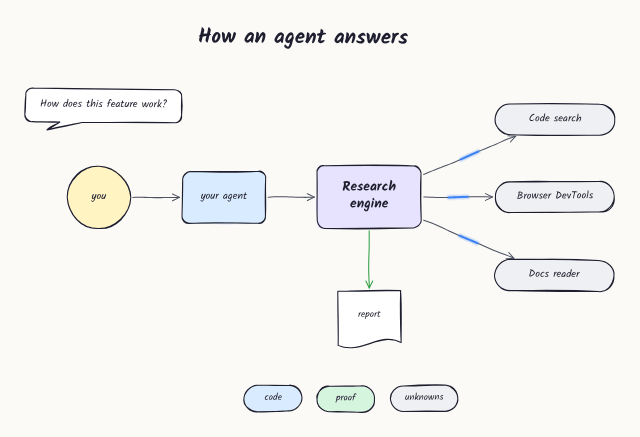

# FlowSketch Studio

A browser-based editor for **hand-drawn flow diagrams that gently come alive**. Shapes float, wobble or "boil" like hand animation. Arrows show the direction of flow with a travelling highlight, a draw-on stroke, marching dashes or a pulse. Everything is configurable, down to switching motion off entirely. You can save editable `.flowsketch` projects and export animated GIFs, video, PNG/JPEG, SVG or a self-contained HTML player. Everything runs locally in the browser, with no account and no server.



**What's changed:** see [CHANGELOG.md](CHANGELOG.md), also shown in the app under Help ▸ What's new.

## Quick start

```bash
npm install
npm run dev        # http://localhost:5173  (also builds the HTML-player bundle first)
npm run build      # type-check + production build into dist/
npm run preview    # serve dist/ on http://localhost:4173
npm test           # unit tests (Vitest, 41 tests)
npm run test:e2e   # end-to-end acceptance tests (needs `npm run preview` running; see below)
```

Requirements: Node 18+ (tested on Node 22). The e2e suite uses Python 3 with `playwright` and `Pillow` (`pip install playwright pillow && python3 -m playwright install chromium`).

## The 60-second tour

1. **Draw.** Press <kbd>U</kbd> (rounded rectangle) and click to drop a shape or drag to size it (<kbd>Shift</kbd> keeps proportions). **The tool stays active.** Draw as many as you like, then press <kbd>Esc</kbd> or <kbd>V</kbd> to go back to Select.
2. **Style once, reuse.** With a drawing tool active, the inspector edits *that tool's remembered defaults*. Defaults are stored separately per tool (blue rectangles and red diamonds stay that way) and persist across sessions. Existing objects are never changed by editing defaults. Select objects to edit them instead.
3. **Write.** Double-click a shape or arrow, or press <kbd>Enter</kbd>, to type. Shapes grow to fit their text.
4. **Connect.** Press <kbd>A</kbd> and drag from one shape to another. Connectors are real relationships: they follow shapes when moved, resized or animated. Drop near a side's dot to pin to that port. Drag mid-dots to add bends, and switch Straight / Curved / Elbow in the inspector. **Swap direction** (inspector, or Arrange ▸ Swap arrow direction) reverses an arrow without redrawing it.
5. **Add icons.** Press <kbd>Shift</kbd>+<kbd>I</kbd> (or the grid button at the end of the toolbar) to open the Icons panel with the 6,257 [Tabler Icons](https://tabler.io/icons) (MIT). Search, then drag an icon onto the canvas or click to add it. Icons attach to arrows, take a label, animate like shapes, and can be recoloured, drawn hand-drawn or given a circle or square background in the inspector.
6. **Play.** <kbd>K</kbd> or the play button. Use the **Squiggle** slider (0–10) for motion and **Hand-drawn** for static sketchiness; the two are independent.
7. **Save & export.** <kbd>Ctrl/⌘ S</kbd> saves a `.flowsketch` file. Work also autosaves in the browser. **Export GIF** renders a seamless loop.

The full shortcut list is under Help ▸ Keyboard shortcuts (<kbd>?</kbd>).

## Animation controls

There are three layers of settings, applied in order:

| Layer | Where | Notes |
|---|---|---|
| Document defaults | Animation ▸ Global animation settings | Duration, loop, seamless snapping, global squiggle/speed multipliers, default shape motion and arrow flow, synchronise / randomise phases, reduced-motion mode |
| Per-object overrides | Inspector ▸ *Shape animation* / *Arrow animation* | Only the values you touch are stored; a blue dot marks an override. ↺ resets a value or a whole section to the document default |
| Playback preview | Bottom bar | Play/pause, stop, restart, scrub, length, speed, loop, all-motion on/off. Nothing here changes saved geometry |

**Shape motion modes:** Gentle float · Organic wobble (smooth outline deformation) · Sketch boil (cycles between three stable hand-drawn variants) · Soft sway (tiny rotation) · Combined (default) · Off. The per-object parameters are squiggle intensity, speed, movement amplitude, rotation, deform, smoothness, phase, delay, and text behaviour (moves with shape / stays stable / drifts on its own). Text glyphs are never deformed.

**Arrow modes:** Travelling highlight (colour, length, opacity, segment count, round/square ends, glow) · Draw on (drawing share, pause, optional erase-from-tail; the arrowhead rides the leading tip) · Marching dashes · Pulse · Static. Every mode also has speed, direction, delay and an optional arrowhead pulse. All of them follow the true connector geometry, including curves and elbows.

**Seamless loops.** With *Seamless* on (the default), every frequency is snapped to a whole number of cycles per loop, so position and velocity match at t = 0 and t = L. Per-object *delays* ease in and therefore break seamlessness; the GIF dialog warns when this applies.

## Saving

* **Native format:** `.flowsketch` is versioned JSON (`format`, `schemaVersion`). It contains all geometry, text, z-order, groups, connector relationships, styles, animation settings, seeds, embedded raster images (data URLs) and export preferences, and never any executable content. On import, every value is validated and coerced. Unknown types are skipped, dangling connector references are detached, duplicate IDs are reissued, and SVG or other non-raster image data is refused. Files from a newer schema version produce a clear error, and older versions are migrated (`src/model/schema.ts`).
* **Save / Save as.** Chromium browsers write back to the same file via the File System Access API. Other browsers fall back to a download.
* **Autosave & recovery.** IndexedDB, about 0.7 s after each change. The last session is restored on reload. File ▸ Recent documents lists up to 12 documents and can restore the autosave.
* Templates: File ▸ New from template (7 built-ins). File ▸ Save as custom template stores your own.

## Exporting

| Format | Notes |
|---|---|
| **Animated GIF** | Size presets of 640 / 1280 / 1920 or custom. 10/15/24/30 FPS, duration, loop count, canvas/white/transparent background, margin, fit-to-content or current view, selection only, 16–256 colours, shared palette, ordered dithering. Shows a live preview at the chosen frame rate, an estimated size, warnings, a progress bar, cancel and retry. Frames are rendered at exact timestamps (`i·L/N`) on an offscreen canvas, so the tab does not need to be visible. Quantisation and encoding run in a Web Worker (gifenc) with one frame in flight, which keeps memory flat. Delays use centisecond rounding so the total stays exact. |
| Video | WebM (VP9/VP8) or MP4 wherever `MediaRecorder` supports it (capability-checked). Recorded in real time, so keep the tab visible. |
| PNG / JPEG | Scale 1–4×, transparent PNG, crop to content or view, margin, selection only, any timestamp. |
| SVG | Real vector paths and `<text>` for the chosen frame. Fonts can optionally be embedded. |
| Standalone HTML | One file containing the document plus the player engine and fonts. It plays offline; click to pause. |
| Clipboard | Copies a PNG image. |

GIFs are limited to 256 colours and compress poorly. For long or large animations, video is usually far smaller.

## Architecture

```
src/
  model/       types.ts (document schema) · defaults.ts · schema.ts (validate/migrate/serialize)
  engine/      noise.ts      deterministic loop-periodic noise + displacement field
               shapes.ts     16 shape outlines → SVG path + sampled polygon (hit-test/attach)
               rough.ts      cached Rough.js geometry (generated once per geometry/style/seed)
               animation.ts  inheritance resolution + per-element motion at time t
               connectors.ts endpoint resolution, straight/curved/elbow routing, arc-length param.
               render.ts     renderDocumentAtTime(doc, t) → Frame   ← single source of truth
               canvasRenderer.ts  Frame → 2D canvas (live view, GIF, PNG, video, player)
               svgExport.ts  Frame → SVG string
               text.ts       shared text measurement + wrapping
  store/       docStore.ts (document + undo/redo) · uiStore.ts (tools, prefs, selection, view, playback) · commands.ts
  editor/      Canvas.tsx (render loop + all pointer interactions) · TextEditor.tsx · hitTest.ts
  ui/          TopBar/MenuBar, Toolbar, Inspector, Timeline, dialogs/*
  export/      gif.ts + gif.worker.ts · raster.ts · video.ts · staticExport.ts
  persistence/ storage.ts (IndexedDB) · files.ts
  player/      standalone HTML player entry (built to player.bundle.js and embedded on export)
  templates/   samples.ts (generated sample diagrams)
```

Key decisions:

* **A dedicated engine, not the Excalidraw component.** Excalidraw owns its scene and render loop. Per-frame deterministic animation, connector-aware motion and frame-exact export would all have meant fighting it. One engine on Rough.js avoids mixing competing renderers.
* **Animation never mutates the document.** `renderDocumentAtTime(doc, t)` is pure. Live playback, every export and the HTML player call it with different `t`, so the preview and the exports match by construction. Unit tests check determinism, non-mutation, zero-intensity stillness, continuity and loop seamlessness.
* **Canvas 2D for display, SVG for vector export.** Both consume the same `Frame`. Selection handles, guides and previews are an SVG overlay drawn from *static* geometry. Hit-testing also uses static geometry, so animation never affects what the pointer grabs.
* **Cheap motion.** Rough.js outlines are generated once and cached. Each frame only translates/rotates them, or warps their coordinates with a smooth displacement field. Off-screen elements are culled in the live view. The glow is drawn as translucent strokes, not blur filters.
* State is split into document (undoable, one history entry per drag, rapid slider changes coalesced), UI/tool prefs (persisted to localStorage) and playback.

## Testing

* `npm test` runs **18 Vitest unit tests**. They cover determinism and non-mutation, intensity 0 = perfectly still, subtle vs. strong motion, frame-to-frame continuity, periodic position and velocity, connectors staying attached when targets move, resize or animate, travel and draw-on behaviour, a lossless round trip for every sample, hostile-file sanitisation, migration, SVG escaping, undo grouping/coalescing/cancel, connector detaching on delete, and per-tool plus shared style memory.
* `npm run test:e2e` (`e2e/run_e2e.py`) runs **18 browser acceptance checks** in headless Chromium using real mouse and keyboard input. They map to spec §23 tests 1–12 plus text editing, PNG/SVG/HTML export, templates, performance and a smoke test of the remaining tools. Exported GIFs are decoded with Pillow to verify the frame count (75 at 5 s × 15 FPS), distinct frames, total duration, the loop flag and that the document is unchanged. Video is recorded and checked for size. To run: `npm run build && npx vite preview --port 4173 & npm run test:e2e`.
* `python3 e2e/make_samples.py` regenerates `samples/` through the real UI.

## Performance (measured)

These figures come from headless Chromium with **software rendering (no GPU)** in a cloud container. They are a pessimistic lower bound, and a normal desktop browser with GPU canvas will be considerably faster.

| Scenario | Result |
|---|---|
| Sample diagram (≈20 objects): `renderDocumentAtTime` | 0.8 ms/frame |
| Sample diagram, live playback | ≈ 43 FPS (software raster) |
| 100 shapes + 150 connectors: `renderDocumentAtTime` | ≈ 14 ms/frame |
| 100 + 150, live playback | ≈ 21–23 FPS (software raster; canvas rasterisation dominates the profile) |
| 100 + 150, drag while paused | ≈ 21 ms per pointer move |
| 5 s × 15 FPS GIF at 640 px | ≈ 2 s, ≈ 0.5 MB |

The 60 FPS target for 100+150 objects is **not demonstrated** here, because no GPU was available to measure on. The JavaScript cost per frame leaves headroom, but this needs confirming on real hardware.

## Implemented vs deferred

**Implemented:** everything in the acceptance list (§24), including:
* 16 shapes with a searchable library, text, freehand pen, highlighter, raster images and the eraser
* Continuous drawing with per-tool remembered styles and an optional shared style; copy/paste style and a format painter
* Selection: marquee, shift-select, groups, lock, z-order, align/distribute, flip
* Transforms: rotate, numeric geometry, keyboard nudging, alt-drag duplicate
* Canvas: smart guides, grid snapping, pinch/space/hand/wheel pan-zoom, light/dark themes
* Undo/redo; real menus
* Animation: five shape modes, five arrow modes, global settings and per-object overrides; presentation mode and fullscreen
* Saving and export: all of the above save/export paths, plus seven templates
* Responsive layout, with the inspector as a bottom sheet on phones

**Deferred / not yet built:**
* AI text-to-diagram (Phase 2; the document-edit command layer in `store/commands.ts` is the intended integration point)
* Keyframes, easing curves and timeline tracks (the timing model already has per-object delay and phase)
* Auto-layout; Find objects; collaboration and accounts
* Rotating multi-selections as a unit; dragging connector labels directly (use the label position/offset sliders)
* Bold/italic for *individual words* (styles apply per text block)
* Transparent GIFs use 1-bit alpha, so anti-aliased edges against transparency can show a faint fringe

## Known limitations

* Video export runs in real time and depends on the browser's `MediaRecorder` codecs. MP4 is only offered where the browser supports it.
* The SVG export is a single frame. For animated vector output, use the HTML player.
* Hachure and cross-hatch fills are regenerated whenever a shape's size changes, so their pattern shifts while you resize. They are stable during animation.
* Rough sketch geometry is cached per element size. Animating 500+ objects with the Wobble deform mode is CPU-heavy, and Float or Sway are much cheaper.

## Deviations from the suggested stack

* **Plain CSS with design tokens instead of Tailwind**, and **hand-written accessible menu/dialog components instead of Radix** (WAI-ARIA menubar pattern, focus trap, Escape handling). Both reduce dependencies with no loss of function and could be swapped later.
* **E2E tests use Playwright for Python** rather than the Node test runner, because a Chromium build was available for it in the build environment.

## Licences

Rough.js (MIT), gifenc (MIT), Zustand (MIT), React (MIT), Vite/Vitest (MIT), idb-keyval (Apache-2.0), Lucide (ISC), Kalam & Inter fonts (SIL OFL 1.1). The UI and branding are original; no Excalidraw assets are used.
